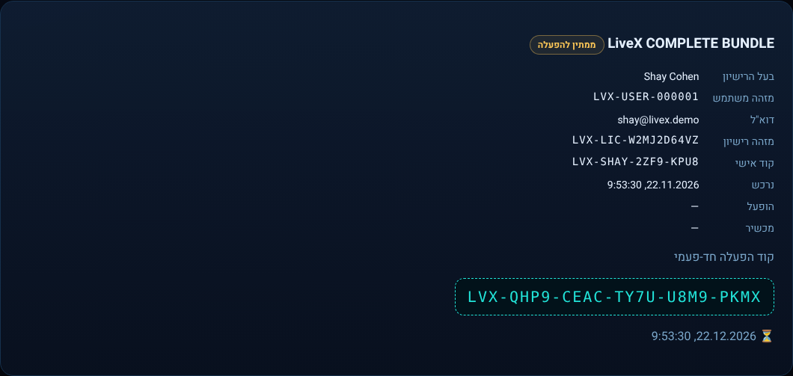
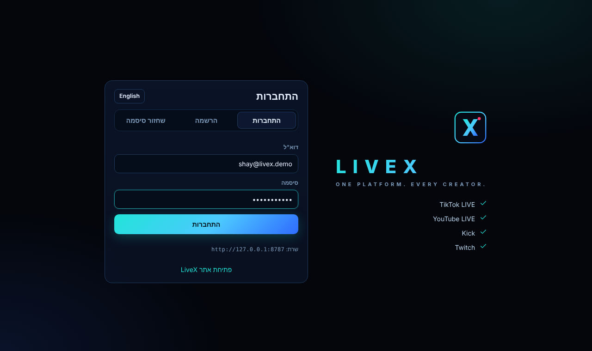
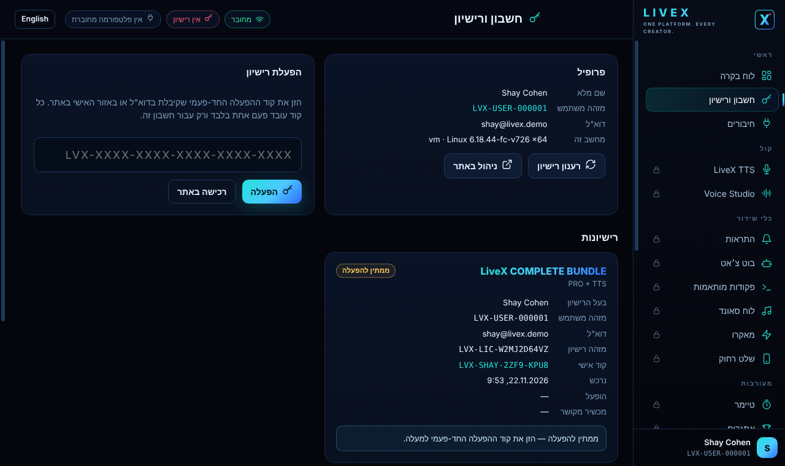
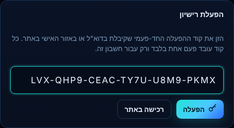
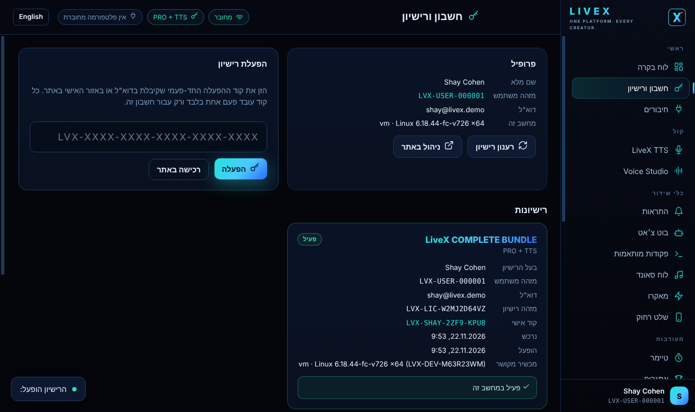
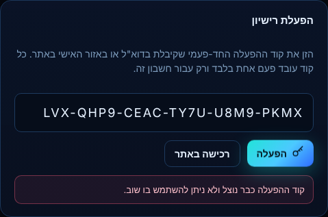

# KEYNAME — איך מפעילים את הרישיון של LiveX

המדריך מסביר מה הוא קוד ההפעלה (KEYNAME), איפה מוצאים אותו, ואיך מזינים אותו בתוכנה.

---

## 1. מה זה KEYNAME?

אחרי רכישה באתר הרשמי של LiveX מקבלים שני קודים. **רק אחד מהם מזינים בתוכנה:**

| קוד | איך הוא נראה | למה הוא משמש |
|---|---|---|
| **קוד הפעלה חד-פעמי (KEYNAME)** | `LVX-XXXX-XXXX-XXXX-XXXX-XXXX` (חמש קבוצות של 4 תווים) | **אותו מזינים ב-LiveX.** עובד פעם אחת בלבד. |
| קוד אישי | `LVX-SHAY-8K29-PQ71` (מתחיל בשם שלך) | מזהה של הרישיון. מוצג באתר ובתוכנה. **לא מזינים אותו.** |

**חשוב לדעת על קוד ההפעלה:**
- עובד **פעם אחת בלבד**. אחרי הפעלה מוצלחת הוא נחסם, גם במחשב אחר.
- שייך **רק לחשבון שקנה אותו**. אי אפשר להפעיל אותו מחשבון אחר.
- תקף ל-**30 יום** מרגע הרכישה.
- **אל תשתף אותו עם אף אחד.**

---

## 2. איפה מוצאים את הקוד?

1. **בדוא"ל:** מיד אחרי הרכישה נשלחת הודעה בשם *"LiveX — קוד ההפעלה שלך"*.
2. **באתר:** נכנסים ל**אזור האישי** ← **רישיונות**. הקוד מוצג שם עד שמשתמשים בו.

> 💡 **בגרסת הבדיקה** (שרת מקומי) המייל לא נשלח לתיבת הדואר. הוא נשמר בתיקייה `data\outbox` של השרת. הקוד מוצג גם באזור האישי באתר `http://127.0.0.1:8787`.

---

## 3. איך מזינים את הקוד ב-LiveX

### שלב 1 — התחברות
פותחים את LiveX ומתחברים **עם אותו חשבון שבו בוצעה הרכישה** (אותו דוא"ל וסיסמה).

### שלב 2 — מסך "חשבון ורישיון"
בתפריט מימין לוחצים על **חשבון ורישיון** 🔑.
(אפשר גם ללחוץ על מודול נעול ואז על **"הזנת קוד הפעלה"**.)

### שלב 3 — הזנת הקוד
בתיבה **"הפעלת רישיון"**:
1. מעתיקים את הקוד מהמייל או מהאתר ומדביקים אותו בשדה (`Ctrl+V`).
   אפשר גם להקליד ידנית. אותיות קטנות, רווחים ומקפים מתוקנים אוטומטית.
2. לוחצים **הפעלה**.

### שלב 4 — הרישיון פעיל ✅
- למעלה מופיע **PRO + TTS** (או רק המוצר שרכשת).
- בכרטיס הרישיון מופיעים **הסטטוס "פעיל"**, השם, ה-User ID, הקוד האישי והמחשב המקושר.
- כל המודולים שרכשת נפתחים.

**איזה רישיון פותח מה:**

| רכשת | מה נפתח |
|---|---|
| LiveX PRO — ₪19.90 | כל המודולים חוץ מ-TTS ו-Voice Studio |
| LiveX TTS — ₪29.90 | הקראת הודעות ו-Voice Studio |
| LiveX COMPLETE BUNDLE — ₪39.90 | הכול |

---

## 4. הודעות שגיאה ומה לעשות

| ההודעה | מה זה אומר | מה עושים |
|---|---|---|
| **קוד ההפעלה אינו תקין** | הקוד הוקלד לא נכון או שאינו קיים | העתק את הקוד שוב מהמייל או מהאתר, והקפד להעתיק את כל 5 הקבוצות. בין 0 ל-O או 1 ל-I אין בלבול, כי הקוד לא משתמש בתווים האלה. |
| **קוד ההפעלה כבר נוצל ולא ניתן להשתמש בו שוב** | הקוד כבר הופעל | אם הרישיון כבר פעיל אצלך, אין צורך לעשות כלום. אם עברת מחשב, ראה סעיף 5. |
| **קוד ההפעלה שייך לחשבון LiveX אחר** | התחברת לחשבון אחר מזה שקנה | התנתק והתחבר עם החשבון שביצע את הרכישה. |
| **תוקף קוד ההפעלה פג** | עברו 30 יום מהרכישה | פנה לתמיכה דרך האזור האישי באתר. |
| **יותר מדי ניסיונות כושלים** | 5 ניסיונות שגויים ברצף | המתן 15 דקות ונסה שוב. |
| **הרישיון כבר פעיל במחשב אחר** | הרישיון מקושר למחשב אחר | העבר אותו דרך האתר (סעיף 5). |
| **רישיון זה בוטל** | הרישיון בוטל, למשל אחרי ביטול עסקה | פנה לתמיכה. |
| **אין חיבור לשרת LiveX** | אין אינטרנט, או ששרת הבדיקה לא רץ | בדוק את החיבור. בגרסת הבדיקה: ודא שהחלון `start-server.cmd` פתוח. |

---

## 5. מעבר למחשב חדש

הקוד החד-פעמי **לא** משמש שוב. מעבירים את הרישיון כך:

1. באתר: **האזור האישי** ← **מכשירים** ← **העברה למחשב חדש**.
2. מזינים את הסיסמה לאימות זהות.
3. לוחצים על הקישור שנשלח לדוא"ל. המחשב הישן מנותק.
4. במחשב החדש: מתחברים ל-LiveX ← **חשבון ורישיון** ← **שימוש במחשב זה**.

אפשר להעביר את הרישיון עד 3 פעמים בשנה.

---

## 6. שאלות נפוצות

**האם צריך להזין את הקוד בכל פעם שפותחים את התוכנה?**
לא. מזינים פעם אחת. בכל פתיחה LiveX בודקת את הרישיון מול השרת אוטומטית.

**מה קורה בלי אינטרנט?**
LiveX ממשיכה לעבוד עד 48 שעות עם אישור רישיון חתום שנשמר במחשב. אחר כך צריך להתחבר לאינטרנט.

**איפה רואים את ה-User ID ואת הקוד האישי?**
ב-LiveX ← **חשבון ורישיון**, ובאתר ← **האזור האישי**.

**התקנתי מחדש את LiveX. צריך קוד חדש?**
לא. מתחברים עם אותו חשבון באותו מחשב, והרישיון חוזר.

